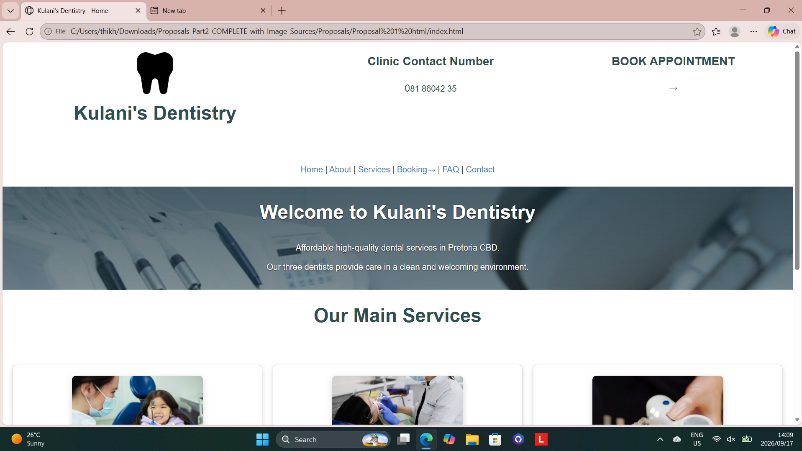
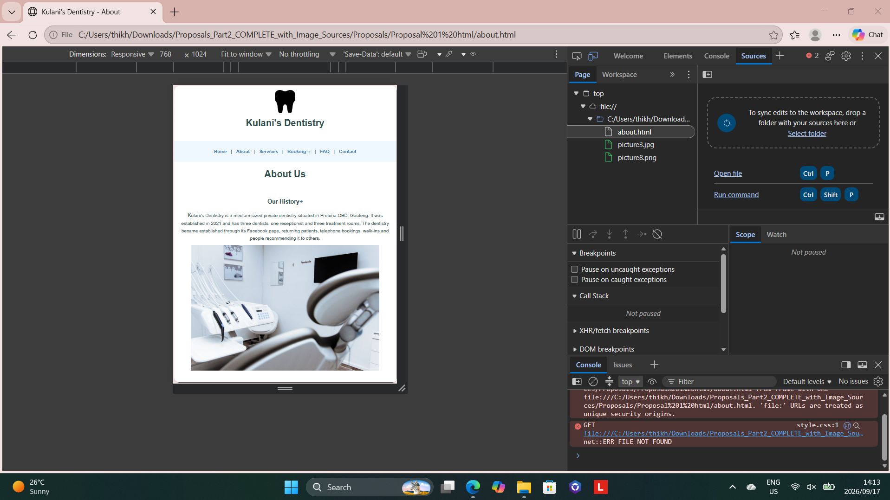
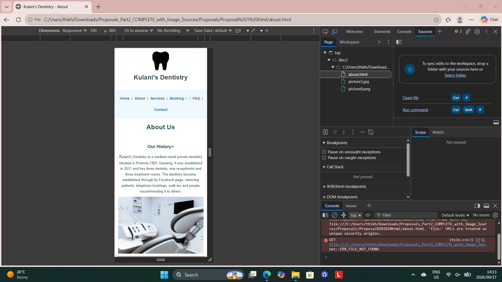

# Kulani's Dentistry

WEDE5020 Part 2 - CSS Styling and Responsive Design

Student: Thikho Nevhutalu  
Student number: ST10526854

## GitHub repository

https://github.com/thikho100/WEDE5020-Formative-2-Part-2

## Project

Kulani's Dentistry is a dentistry website based in Pretoria CBD. The website contains the Home, About, Services, Booking, FAQ, Contact, Staff Login and Staff Appointment pages.

Part 2 focuses on styling the website with an external CSS file, improving the layout and making the pages responsive on desktop, tablet and mobile screens.

## Files

- `index.html` - Home page
- `about.html` - About page
- `services.html` - Dental services
- `enquiry.html` - Appointment booking form
- `faq.html` - Frequently asked questions
- `contact.html` - Contact information and contact form
- `staff-login.html` - Staff login
- `admin.html` - Staff appointment page
- `style.css` - Part 2 stylesheet

## Part 2 CSS features

The stylesheet includes:

- blue and white colour theme
- Aptos/Arial fonts
- spacing, borders and shadows
- Flexbox header layout and CSS Grid responsive layouts
- responsive images
- desktop, tablet and mobile media queries
- hover and focus effects
- button press effect
- logo rotation
- booking-arrow rotation
- service image magnification
- Staff Login text magnification
- form focus effects
- FAQ plus-sign rotation
- background image on the home banner
- entrance animation
- pseudo-classes and pseudo-elements
- responsive admin appointment table

## Responsive design

The website has breakpoints at approximately:

- Desktop: above 960px
- Tablet: 601px to 960px
- Mobile: 600px and below

Service cards move from three columns on desktop, to two columns on tablet and one column on mobile. Forms and contact sections also become single-column on smaller screens.

## Stylesheet linking

The external `style.css` file is linked in the `<head>` of every HTML page. The original HTML structure and content were kept the same apart from this stylesheet link.

## Responsive screenshots

### Desktop view

### Tablet view

### Mobile view

## Image source credits

| Website file | Source |
| --- | --- |
| `picture1.jpg` | Nadezhda Moryak / Pexels - *Dentist Showing a Dental Tool to Patient* - https://www.pexels.com/photo/dentist-showing-a-dental-tool-to-patient-7800560/ |
| `picture2.jpg` | Nadezhda Moryak / Pexels - *A Woman in White Coat Wearing Blue Face Mask* - https://www.pexels.com/photo/a-woman-in-white-coat-wearing-blue-face-mask-7803054/ |
| `picture3.jpg` | Pavel Danilyuk / Pexels - *Screen and Dental Instruments in Doctors Office* - https://www.pexels.com/photo/screen-and-dental-instruments-in-doctors-office-6809639/ |
| `picture4.jpg` | Nadezhda Moryak / Pexels - *A Woman Sitting on a Dental Chair* - https://www.pexels.com/photo/a-woman-sitting-on-a-dental-chair-7803058/ |
| `picture5.jpg` | Arda Kaykısız / Pexels - *Redhead Dentist Working* - https://www.pexels.com/photo/redhead-dentist-working-19976581/ |
| `picture6.jpg` | Andrea Piacquadio / Pexels - *Dentist Working on Woman's Teeth* - https://www.pexels.com/photo/dentist-working-working-on-woman-s-teeth-3779713/ |
| `picture7.jpg` | Polina Zimmerman / Pexels - *Crop Female Dentist Showing Right Way of Teeth Cleaning* - https://www.pexels.com/photo/crop-female-dentist-showing-right-way-of-teeth-cleaning-3958092/ |
| `picture8.png` | Rawpixel - black tooth silhouette PNG - https://www.rawpixel.com/image/12832085/png-black-white-logo-silhouette-generated-image-rawpixel |

## CSS references

[1] MDN Web Docs, "Using media queries." https://developer.mozilla.org/en-US/docs/Web/CSS/Guides/Media_queries/Using  
[2] MDN Web Docs, "Pseudo-classes." https://developer.mozilla.org/en-US/docs/Web/CSS/Reference/Selectors/Pseudo-classes  
[3] MDN Web Docs, "transform." https://developer.mozilla.org/en-US/docs/Web/CSS/Reference/Properties/transform  
[4] MDN Web Docs, "Using CSS animations." https://developer.mozilla.org/en-US/docs/Web/CSS/Guides/Animations/Using  
[5] Orlando Pirates Football Club, official website. https://www.orlandopiratesfc.com/

## Changelog

### 17 September 2026 - Part 2 CSS redo

- Added a new external `style.css` based on the existing HTML structure.
- Linked `style.css` to all eight HTML pages without restructuring the original HTML.
- Added responsive desktop, tablet and mobile rules.
- Added Flexbox header layout.
- Added animation, hover, focus, transform, rotation and magnification effects.
- Added a CSS background image and responsive form/table styling.
- Added this README.
